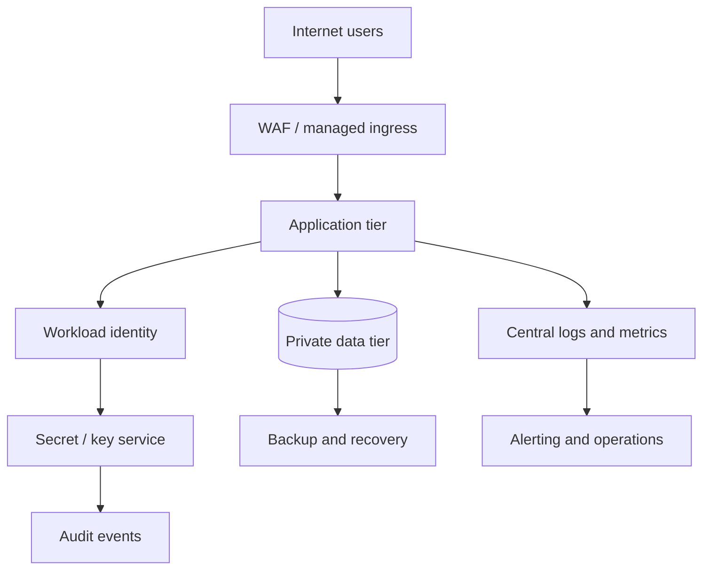

# Pattern — Secure Multi-Tier Application Platform

**Status:** Reference pattern; not deployed  
**Applies to:** Azure or AWS implementations after provider-specific design review

## Intent
Separate public ingress, application workloads and data services so each tier has an explicit trust boundary. Centralize telemetry and use workload identity rather than embedded credentials.

## Conceptual flow

## Design principles
- Expose only the intended ingress endpoint; do not publish the data tier.
- Restrict application-to-data paths to required protocols and destinations.
- Use managed workload identity and scoped permissions.
- Store secrets and encryption keys in an appropriate managed service.
- Send platform and application telemetry to a controlled destination.
- Define backup retention, restore objectives and recovery tests.
- Apply budgets, tagging and cleanup controls in learning environments.

## Trade-offs to evaluate
- Managed ingress/WAF capabilities and associated cost.
- Private endpoint and DNS complexity.
- Availability-zone resilience versus cost.
- Centralized observability cost and retention.
- Operational skills required for the chosen platform.

## Required evidence before calling this pattern implemented
A provider-specific diagram, ADRs, threat model, tested Terraform, access-path validation, alert evidence, recovery test and cost estimate.